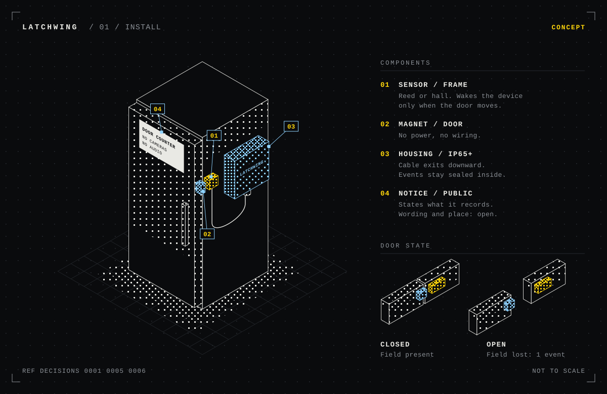
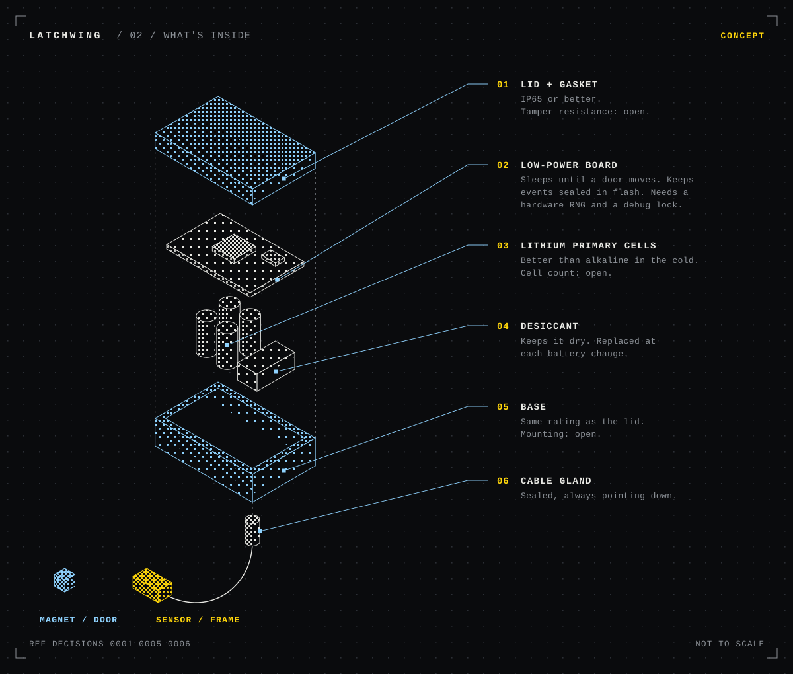

# latchwing

A sensor data capture - small, low-cost device that records when a 24/7 community fridge or cabinet door opens and closes.

## Context

Community pantries run on volunteers and shared goodwill, but it's hard to know how often the fridge and cabinets are used, or when. Latchwing is a DIY project aiming to capture simple open/close events so the team can see usage patterns, plan restocking, and make the case for support, without cameras or tracking people.

Status: early idea. Hardware, parts, and plan to follow.

## Principles

- **Privacy first.** Log door events only. No cameras, no audio, no identifying anyone.
- **Simple and cheap.** Off-the-shelf parts, easy to build and replace.
- **Weatherproof.** Built for an outdoor setting and Chicago seasons.
- **Low maintenance.** Long battery life or minimal power draw; volunteers shouldn't have to babysit it.
- **Open and documented.** Anyone should be able to rebuild it from this repo.
- **Useful, not noisy.** Collect only what helps run the pantry better.

## Concept

These drawings show the current [decisions](docs/decisions/), for reference. Parts aren't chosen yet, so the real device may look different.

